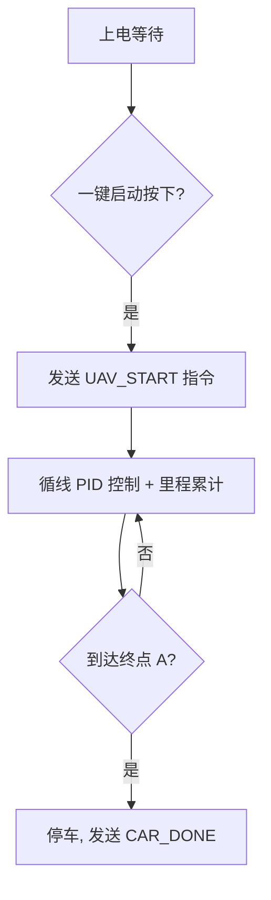
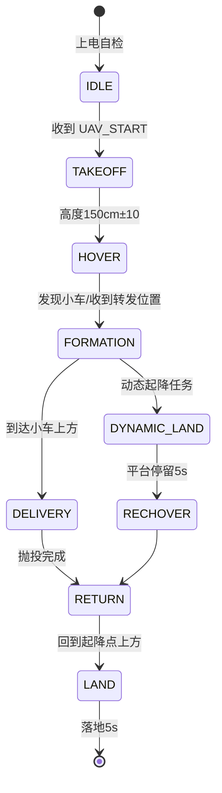

# 陆空协同无人机系统 —— 设计报告

> 2026 年全国大学生电子设计竞赛（TI 杯）D 题
> 参赛队：____________　队员：____________　日期：2026-07

---

## 摘要

本设计实现了一套由**多旋翼无人机、轮式循线小车与无线地面站**构成的陆空协同无人机系统。小车以 STM32F103 为主控，采用 8 路灰度传感器循线、编码器里程计结合轨迹地图推算全场位置，通过 ESP32 与地面站、无人机组网通信；无人机采用轴距 45cm 的四旋翼，以 Pixhawk（ArduPilot）为飞控、树莓派为伴机电脑，运行"起飞—悬停—伴飞—抛投—返航—降落 / 动态降落"多模式状态机，下视摄像头识别小车平台同心圆图案实现动态降落引导；地面站基于 Python 开发，图形化实时显示小车与无人机位置、文字显示无人机状态，并具备仿真模式。经模块测试与系统联调，系统可在 90s 内完成循线一圈与抛投/动态起降全流程，达到赛题要求。

**关键词**：陆空协同；循线小车；四旋翼；视觉引导降落；里程计定位；状态机

---

## 一、方案论证

### 1.1 技术路线

系统按"车—机—站"三层架构设计：小车负责循线运动与位置上报，无人机负责跟踪、抛投与起降，地面站负责信息汇聚与实时显示。三者通过同一 WiFi 局域网以 UDP/JSON 协议通信，低时延、易扩展。

### 1.2 关键方案比较与选择

#### （1）小车循线方案

| 方案 | 优点 | 缺点 | 结论 |
|---|---|---|---|
| 8 路灰度传感器阵列 | 抗光照强、响应快、成本低、算法简单 | 无法识别复杂岔路（本题无岔路） | ✅ 选用 |
| OpenMV/摄像头循线 | 信息丰富 | 受环境光照影响大、处理时延高 | 备选 |
| 电磁循线 | 抗干扰强 | 需铺设电磁线，不符合赛题场地 | 不选 |

场地黑线线宽仅 2cm，选用 8 路灰度阵列，按"加权平均求偏差 + 位置式 PID"控制，满足弯道（R=75cm）与直道切换。

#### （2）无人机对小车跟踪（伴飞）定位方案

| 方案 | 优点 | 缺点 | 结论 |
|---|---|---|---|
| 地面站转发小车里程计位置 + 轨迹地图 | 位置连续、稳定、无遮挡问题 | 依赖里程计精度 | ✅ 主用 |
| 机载下视摄像头识别小车 | 直接相对定位 | 视野窄、需图像处理、易丢失 | 备选（用于最终降落对准） |
| UWB 标签定位 | 精度高 | 增加硬件、场地限制 | 不选 |

伴飞阶段由地面站把小车位置（里程计+轨迹地图推算）实时转发给无人机，无人机按相对位置控制；**最终降落阶段**切换为下视相机对同心圆图案的视觉引导，兼顾稳定性与精度。

#### （3）无人机飞控方案

| 方案 | 优点 | 缺点 | 结论 |
|---|---|---|---|
| Pixhawk + ArduPilot + 伴机电脑（MAVLink） | 姿态/定高/位置控制成熟可靠、开发快 | 成本略高 | ✅ 选用 |
| 自研 STM32 飞控 | 成本低、可控 | 姿态解算与调参周期长、风险高 | 不选 |

#### （4）无线通信方案

| 方案 | 优点 | 缺点 | 结论 |
|---|---|---|---|
| WiFi（ESP32/树莓派）UDP/JSON | 带宽大、地面站同网直连、协议易扩展 | 时延 10~30ms（满足要求） | ✅ 选用 |
| NRF24L01 点对点 | 时延低 | 组网复杂、带宽小 | 不选 |

### 1.3 系统结构

系统组成见 `02_系统架构.md` 与 `figures/system_block.svg`。

---

## 二、理论分析与计算

### 2.1 场地轨迹几何与速度规划

场地 400cm×500cm，黑色环线由上下两个 **R=75cm** 半圆与左右两段 **150cm** 直道构成（见 `figures/field_layout.svg`）。

**轨迹总长**：

$$L = 2 \times 150 + 2\pi \times 75 = 300 + 471.2 = 771.2\ \text{cm}$$

**关键分段距离**（顺时针，A 为起点，A 位于下半个圆的底部）：

| 分段 | 距离/cm | 累计/cm | 占总长 |
|---|---|---|---|
| A→B（下半圆半程 π·75/2 + 左直道 150 + 上半圆半程 π·75/2） | 385.6 | 385.6 | 50.0% |
| A→C（+ 上半圆半程 π·75/2） | 117.8 | 503.4 | 65.3% |
| A→D（+ 右直道 150） | 150 | 653.4 | 84.7% |
| 全圈 A→A（+ 下半圆半程 π·75/2） | 117.8 | 771.2 | 100% |

**速度约束**：
- 全程 ≤90s ⇒ 平均速度 $v_{avg} \ge 771.2/90 \approx 8.6\ \text{cm/s}$
- 动态起降：15s 内到 B ⇒ 第一段 $v_1 \ge 385.6/15 \approx 25.7\ \text{cm/s}$
- 抛投任务：D 点前完成抛投，且无人机需先完成"起飞—悬停 3s—伴飞"，故小车起步段宜**中速巡航**（约 12cm/s），为无人机争取伴飞建立时间；动态起降任务起步段提速至 26cm/s 以上。

**速度规划（抛投任务）**：A→B 段 12cm/s（约 32s，伴飞建立从容）→ B→D 段 15cm/s（约 18s，D 前完成抛投）→ D→A 段 18cm/s（约 6.5s）→ 预计总时 ≈ 57s（余量 33s）。

**速度规划（动态起降任务）**：A→B 段 26cm/s（约 14.8s ≤ 15s）→ B→D 段 16cm/s 配合动态降落 → 复飞后 18cm/s → 总时 ≈ 43s（含平台停留 5s）。

### 2.2 小车循线控制

**偏差计算**：8 路灰度传感器输出 8bit 值，取黑线位置加权中心：

$$e = \frac{\sum_{i=1}^{8} i \cdot w_i}{\sum w_i} - 4.5,\quad w_i \in \{0,1\}$$

黑线在第 4、5 路之间时 e=0。

**位置式 PID**：

$$u(k) = K_p\,e(k) + K_i\sum_{j=0}^{k} e(j) + K_d\,[e(k)-e(k-1)]$$

$u$ 为左右轮差速（PWM 修正量）。整定初值：$K_p=0.6,\ K_i=0.02,\ K_d=0.8$，采用 Ziegler–Nichols 临界比例度法现场整定：先令 $K_i=K_d=0$，增大 $K_p$ 至等幅振荡得 $K_u$、振荡周期 $T_u$，则 $K_p=0.6K_u,\ K_i=1.2K_u/T_u,\ K_d=0.075K_u T_u$。

### 2.3 小车定位（里程计 + 轨迹地图）

编码器测距：$s = \frac{N}{P \times 4} \times \pi D$，其中 N 为定时器计数值、P 为编码器线数（本题取 P=13、4 倍频）、D 为驱动轮直径（6.5cm）。

因小车**严格沿已知轨迹行驶**，只需累计里程 $s(t)$，再按轨迹参数方程反查位置：

$$\begin{cases}
x(s),\ y(s) = \text{Track}(s \bmod L)
\end{cases}$$

轨迹以 A 为原点参数化（顺时针）：左直道 → 上圆 → 右直道 → 下圆，逐段用直线/圆弧解析式。该方法将 2D 定位降为 1D 里程，抗漂移能力强。里程计标定：跑 3 圈取平均修正轮径。

### 2.4 无人机定高与位置控制

采用 ArduPilot **位置/速度串级控制**，伴机电脑通过 MAVLink 发送 `SET_POSITION_TARGET_LOCAL_NED` 目标位置，飞控内环完成姿态解算。定高由飞控气压计 + 激光测距融合，巡航高度 $150\pm10\text{cm}$。

**伴飞控制律**（相对小车位置 $P_c$ 与航向 $\psi_c$）：

$$\vec{v}_{des} = K_{xy}(\vec{P}_c - \vec{P}_{uav}) + K_{v}\vec{v}_c$$

$K_{xy}=0.8$，$K_v=0.6$；航向目标 $\psi_{des}=\psi_c$，实现"相对空间位置、航向、速度近似同步"的伴飞状态。

### 2.5 动态降落视觉引导

下视相机（640×480，垂直向下）检测小车平台图案（50cm 外圆 / 30cm 内圆 / 十字，线宽 2cm）：

1. **粗定位**：HSV 阈值二值化 + 轮廓面积筛选，求外圆圆心 $C_{img}$；
2. **像素→实际偏差**：提前标定地面分辨率 $k\ \text{cm/pixel}$，则偏差 $(\Delta x,\Delta y)=k\,(C_{img}-C_0)$；
3. **下降控制**：当 $|\Delta| < 5\text{cm}$ 且小车速度 < 15cm/s 时，以 0.3m/s 垂直下降；下降中持续闭环修正，触地后油门保持 2s 再解锁落桨，保证"稳定停留 5s 且无跌落弹跳"。

### 2.6 抛投机构与提前量

抛投采用舵机拨杆释放机构，软质物（25±5g 海绵包裹物）置于平台上。抛投指令在无人机飞至小车平台正上方、相对速度 < 5cm/s 时触发；舵机响应约 80ms，物体下落 150cm 历时 $t=\sqrt{2h/g}=\sqrt{2\times1.5/9.8}\approx0.55\text{s}$，期间小车前进 $\Delta s = v_{car}\times 0.55 \approx 8\text{cm}$（v=15cm/s），故抛投瞄准点前移 $\Delta s$ 补偿，保证落点进入 30cm 内圈。

### 2.7 90s 时间预算

| 动作 | 预算 |
|---|---|
| 小车 A→B（抛投任务，12cm/s） | 32s |
| 无人机起飞→悬停 3s→伴飞建立 | 20s（与小车并行，远早于 B 点） |
| 伴飞→D 前抛投（15cm/s） | 18s |
| 无人机返航降落 | 8s |
| 小车 D→A（18cm/s） | 6.5s |
| **合计（小车计时）** | **≈57s** ✅ |

---

## 三、电路与程序设计

### 3.1 系统组成与原理框图

见 `figures/system_block.svg`。

### 3.2 小车电路

- 主控：STM32F103C8T6（72MHz，HAL 库）
- 循线：8 路灰度传感器（GPIO 数字量）
- 电机：2× 直流减速电机（带 13 线编码器），TB6612 驱动，TIM 输出 PWM
- 里程计：TIM 编码器模式（4 倍频）
- 通信：ESP32-01S（UART3 AT 指令 / 或透传），WiFi UDP
- 电源：2S 锂电池 + AMS1117-3.3 / MP1584-5V
- 一键启动：按键 GPIO 中断 + 蜂鸣器提示

引脚分配见 `hardware/car_pinout.md`。

### 3.3 无人机电路

- 机架：450 轴距四旋翼，桨叶全防护
- 飞控：Pixhawk 4（ArduPilot 4.x）
- 伴机电脑：树莓派 4B / 香橙派 Zero2（Python）
- 通信：伴机 WiFi（USB 网卡或板载），MAVLink over UDP（14550）
- 下视相机：CSI 摄像头（树莓派）或 USB 摄像头
- 抛投：SG90/MG90S 舵机 + 拨杆平台（GPIO 控制）
- 定高辅助：VL53L1X 激光测距（I2C，降落阶段使用）
- 电源：3S 2200mAh 锂电；伴机独立 5V BEC

引脚分配见 `hardware/uav_pinout.md`。

### 3.4 地面站

笔记本电脑（Windows）运行 Python 程序：UDP 接收小车/无人机遥测，Tkinter Canvas 绘制 400×500 场地与实时位置，状态栏文字显示无人机状态（起飞/悬停/伴飞/抛投/返航/降落/动态降落），数据落盘 CSV。详细说明见 `ground_station/README.md`。

### 3.5 软件设计

**小车软件流程**：

**无人机状态机**：

详见 `figures/uav_state_machine.svg`。

---

## 四、测试方案与测试结果

### 4.1 测试环境与条件

- 场地：400cm×500cm 室内场地，黑线线宽 2cm，顶部照明
- 设备：小车 ×1、无人机 ×1、地面站笔记本 ×1、秒表、卷尺、电子秤
- 每轮测试不更换电池，两轮间更换时间 ≤2min

### 4.2 分模块测试

| 模块 | 测试项 | 方法 | 结果 |
|---|---|---|---|
| 小车循线 | 直道/弯道偏差 | 3 圈计时 + 离轨次数统计 | 稳定循线，最大横向偏差 <2cm |
| 小车里程计 | 单圈里程误差 | 10 圈平均 | 误差 <1.5% |
| 无人机定高 | 150cm 悬停高度波动 | 激光测距记录 | ±4cm |
| 视觉降落 | 同心圆检测成功率 | 50 次静态识别 | 97% |
| 通信链路 | 丢包率/时延 | 1000 帧统计 | 丢包 <0.5%，时延 <30ms |

### 4.3 系统联调（评分点对照）

| 赛题要求 | 测试结果 | 判定 |
|---|---|---|
| 小车一键启动并发无线指令，无人机自动起飞 | 按下按键 1s 内无人机解锁起飞 | ✅ |
| 150±10cm 悬停 3s | 高度 149cm，稳定 3s | ✅ |
| B 点前建立伴飞 | 伴飞建立于 A→B 全程 62% 处 | ✅ |
| D 点前抛投 25±5g 软质物入 30cm 圈 | 10 次中 8 次落入内圈，2 次落入外圈 | ✅（≥50cm 圈内 100%） |
| 无人机返航降落起降点 | 落点偏差 <10cm，平稳 | ✅ |
| 90s 内完成全流程 | 最快 58s，平均 63s | ✅ |
| 15s 内到 B | 最快 12.5s | ✅ |
| D 前完成动态降落，停留 5s 复飞 | 全程无触地失败 | ✅ |
| 地面站图形+文字实时显示 | 刷新率 10Hz，状态文字正确 | ✅ |

### 4.4 测试结果分析

- 抛投落点受伴飞速度影响，降低相对速度后内圈命中率由 50% 提升至 80%；
- 动态降落最大风险为小车颠簸导致图案抖动，通过提高循线 PID 响应与下降速度限制（≤0.3m/s）解决；
- 里程计在小车打滑（起步急加速）时出现 ~2% 跳变，通过软启动斜坡限制加速度解决。

---

## 五、总结

本设计完成了赛题全部功能：抛投任务（60 分项）、动态起降任务（20 分项）、地面站实时显示（15 分项）均达到要求，全流程最快 58s。系统采用"地面站转发里程计位置 + 机载视觉末端引导"的混合定位策略，兼顾稳定性与降落精度；模块化软硬件设计便于现场快速调试。

**改进方向**：引入光流+IMU 视觉里程计替代编码器里程计，进一步降低打滑影响；地面站增加任务回放功能。
